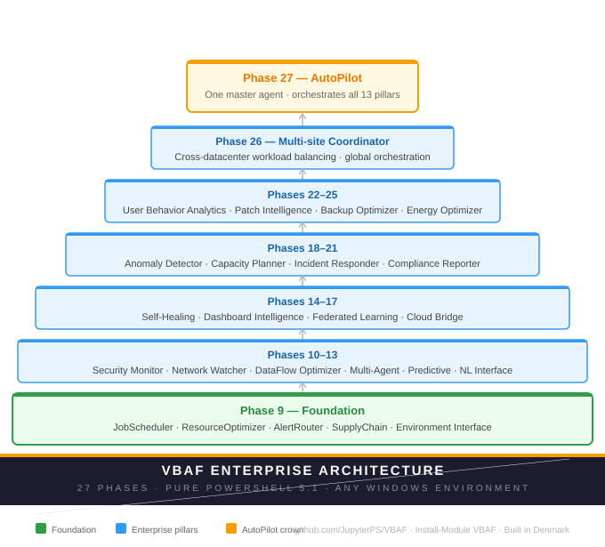

# VBAF — Visual AI & Reinforcement Learning Framework

> **v6.2.3** · PowerShell 5.1 · Educational AI Framework · Learn by doing

[](LICENSE)
[](https://github.com/PowerShell/PowerShell)
[](https://www.powershellgallery.com/packages/VBAF)
[](https://www.powershellgallery.com/packages/VBAF)
[](https://github.com/JupyterPS/VBAF/stargazers)

## Architecture

[](https://github.com/JupyterPS/VBAF)

## What is VBAF?

VBAF is a **hands-on educational framework** for learning artificial intelligence and reinforcement learning concepts — written entirely in PowerShell 5.1 that ships with every Windows PC.

No Python. No Jupyter. No cloud dependencies. Just open PowerShell and start learning.

**What you can learn with VBAF:**

- How neural networks learn through backpropagation
- How Q-learning agents discover optimal strategies without being told the rules
- How Deep Q-Networks (DQN) scale reinforcement learning to complex problems
- How multiple agents compete and cooperate in shared environments
- How to normalise, scale and clean data before feeding it to an AI model

**Why PowerShell?**

Because the code is readable. Every function in VBAF is written to be understood — not just executed. You can open any `.ps1` file and see exactly what the algorithm is doing, line by line. That is the point.

---

## Where to Start

| Guide | Who it is for |
|-------|---------------|
| [Getting Started](docs/GettingStarted.md) | First time users -- install, load, run your first example |
| [Learning Path](docs/LEARNING-PATH.md) | Complete beginners -- 119 steps, hand-holding all the way |
| [Quick Start](#quick-start) | Developers who want commands fast -- scroll down |

---

## Quick Start

```powershell
# Install
Install-Module VBAF -Scope CurrentUser

# Navigate to your working folder
cd "C:\Users\YourName\OneDrive\WindowsPowerShell"

# Load everything
. .\VBAF.LoadAll.ps1

# Run the XOR example -- the classic neural network benchmark
cd examples\01-XOR-Network
. .\Run-Example-01.ps1

# Watch a Q-learning agent learn castle sequences
cd ..\02-Castle-Learning
. .\Run-Example-02.ps1

# See competing market agents emerge pricing strategies
cd ..\03-Market-Simulation
. .\Run-Example-03.ps1
```

---

## Learning Path

Start here and work through in order:

| Step | Example | What you learn |
|------|---------|----------------|
| 1 | [XOR Network](examples/01-XOR-Network/) | Neural networks, backpropagation, convergence |
| 2 | [Castle Learning](examples/02-Castle-Learning/) | Q-learning, rewards, emergent strategy |
| 3 | [Market Simulation](examples/03-Market-Simulation/) | Multi-agent competition, Nash equilibrium |
| 4 | [Learning Dashboard](examples/04-Learning-Dashboard/) | Visualising training progress |
| 5 | [Validation Dashboard](examples/05-Validation-Dashboard/) | Evaluating model quality |
| 6 | [Custom Agent](examples/06-Custom-Agent/) | Build your own RL environment |

Each example folder contains a `Run-Example-XX.ps1` launcher -- just run that.

---

## Educational Tools

Three interactive tools for guided learning:

```powershell
# Console teacher -- 7 topics, press Enter to advance
Start-VBAFTeach

# Jump to one topic directly
Start-VBAFTeach -Topic "DQN"
Start-VBAFTeach -Topic "QLearning"
Start-VBAFTeach -Topic "Enterprise"
Start-VBAFTeach -Topic "Evolution"

# Interactive experiment station -- pick algorithm, configure, watch it train
Start-VBAFPlayground

# Jump to one playground directly
Start-VBAFPlayground -Algorithm "DQN"
Start-VBAFPlayground -Algorithm "Enterprise"
Start-VBAFPlayground -Algorithm "Supervised"
```

---

## Documentation

| Guide | Who it is for |
|-------|---------------|
| [Getting Started](docs/GettingStarted.md) | First time users -- install, load, first run |
| [Learning Path](docs/LEARNING-PATH.md) | Complete beginners -- 119 steps in the right order |
| [Cheat Sheet](VBAF.CheatSheet.md) | "I want to..." -- problem-first quick reference |
| [Theory](docs/Theory.md) | The math behind every algorithm with paper references |
| [Architecture](docs/Architecture.md) | How the framework layers fit together |
| [API Reference](docs/API-Reference.md) | Every function and class documented |
| [FAQ](docs/FAQ.md) | Common questions and answers |
| [Tutorials](docs/tutorials/) | Step-by-step walkthroughs |
| [Teaching Materials](docs/teaching/) | Course outlines, exam questions, semester plans |
| [Case Studies](docs/case-studies/) | Real learning experiments and results |

---

## What is in the box?

### Core AI modules

| Module | What it teaches |
|--------|----------------|
| `VBAF.Core.AllClasses.ps1` | Neural network architecture -- layers, weights, activations, backpropagation |
| `VBAF.RL.QLearningAgent.ps1` | Q-learning -- the foundation of modern RL |
| `VBAF.RL.DQN.ps1` | Deep Q-Networks -- combining neural nets with RL |
| `VBAF.RL.PPO.ps1` | Proximal Policy Optimisation -- stable policy gradients |
| `VBAF.RL.A3C.ps1` | Async Advantage Actor-Critic -- parallel RL workers |
| `VBAF.RL.Environment.ps1` | Environments -- CartPole, GridWorld, RandomWalk |
| `VBAF.RL.Trace.ps1` | Watch any agent step by step -- `Get-VBAFTrace` |
| `VBAF.RL.ProductionCell.ps1` | A production cell world, hand-written rules and an honest measurer |
| `VBAF.RL.Evolution.ps1` | Build, train and evolve a brain -- `Invoke-VBAFEvolutionStudy` |
| `VBAF.Business.MarketEnvironment.ps1` | Multi-agent market simulation |

### Supervised learning modules

| Module | What it teaches |
|--------|----------------|
| `VBAF.ML.Regression.ps1` | Linear, Ridge, Lasso, Logistic regression |
| `VBAF.ML.Trees.ps1` | Decision trees and Random forests |
| `VBAF.ML.Clustering.ps1` | KMeans, DBSCAN, Hierarchical clustering |
| `VBAF.ML.NaiveBayes.ps1` | Gaussian, Multinomial, Bernoulli Naive Bayes |
| `VBAF.ML.DataPipeline.ps1` | Imputation, scaling, encoding |
| `VBAF.ML.AutoML.ps1` | Grid, random and Bayesian hyperparameter search |
| `VBAF.ML.Explainability.ps1` | SHAP, LIME, permutation importance |

### Educational tools

| Tool | What it does |
|------|-------------|
| `VBAF.Teach.ps1` | Console teacher -- 7 topics, step by step |
| `VBAF.Playground.ps1` | Interactive experiment station -- no coding needed |
| `VBAF.Benchmark.ps1` | Compare agents head to head with CSV export |

### Visualisation

| Module | What it teaches |
|--------|----------------|
| `VBAF.Visualization.LearningDashboard.ps1` | Live training curves |
| `VBAF.Visualization.MarketDashboard.ps1` | Live market competition |
| `VBAF.Visualization.EvolutionWindow.ps1` | Evolution window -- lineage, one shift step by step, brains side by side |
| `VBAF.Art.CastleCompetition.ps1` | Visualising multi-agent competition |

---

## The XOR benchmark

XOR is the classic test of whether a neural network can learn non-linear patterns.
A linear model cannot solve it -- you need at least one hidden layer.

```powershell
. .\VBAF.LoadAll.ps1
cd examples\01-XOR-Network
. .\Run-Example-01.ps1

# Expected output:
# XOR Truth Table:
#   0 XOR 0 = 0  (predicted: 0.02)
#   0 XOR 1 = 1  (predicted: 0.97)
#   1 XOR 0 = 1  (predicted: 0.96)
#   1 XOR 1 = 0  (predicted: 0.03)
# Epochs: 847  Loss: 0.008
```

If you see predictions close to 0 and 1 -- the network learned. That is backpropagation working.

---

## The Castle Learning experiment

A Q-learning agent generates castle sequences and discovers that variety is rewarded.
No strategy is programmed. The agent finds it through trial, error and reward signals.

```powershell
cd examples\02-Castle-Learning
. .\Run-Example-02.ps1

# Watch the Q-table grow:
# Episode   1 | Q-Table:  10 entries | Exploit:  0.0%
# Episode  50 | Q-Table: 286 entries | Exploit: 11.6%
# Episode 100 | Q-Table: 383 entries | Exploit: 22.2%
```

This is reinforcement learning in its purest form -- learning from reward signals, not from labelled examples.

---

## Beyond the basics -- Enterprise Automation

Once you understand the foundation phases (1-9), VBAF includes 14 enterprise pillars built on the same core -- each one a working DQN agent solving a real IT automation problem.

| Phase | Pillar | What it automates | Trained minus best fixed action (3 seeds) | Beats best fixed |
|---|---|---|---|---|
| 14 | Self-Healing | Detects and fixes system problems automatically | +314 +/- 134 | 3 of 3 |
| 15 | Dashboard | Intelligent cache and refresh management | +390 +/- 94 | 3 of 3 |
| 16 | Federated Learning | Distributed model training across nodes | +415 +/- 59 | 3 of 3 |
| 17 | Cloud Bridge | Local vs cloud workload balancing | +416 +/- 60 | 3 of 3 |
| 18 | Anomaly Detector | Spots unusual patterns before they become incidents | +416 +/- 60 | 3 of 3 |
| 19 | Capacity Planner | Predicts resource needs before you run out | +419 +/- 41 | 3 of 3 |
| 20 | Incident Responder | Automated incident triage and containment | +414 +/- 59 | 3 of 3 |
| 21 | Compliance Reporter | GDPR/ISO27001 compliance monitoring | +204 +/- 13 | 3 of 3 |
| 22 | User Behavior Analytics | Detects insider threats and anomalous access | +175 +/- 65 | 3 of 3 |
| 23 | Patch Intelligence | Risk-aware patch scheduling and rollback | +175 +/- 65 | 3 of 3 |
| 24 | Backup Optimizer | Adaptive backup strategy optimisation | +175 +/- 65 | 3 of 3 |
| 25 | Energy Optimizer | Reduces power consumption intelligently | +175 +/- 65 | 3 of 3 |
| 26 | Multi-Site Coordinator | Cross-datacenter workload balancing | +175 +/- 65 | 3 of 3 |
| 27 | AutoPilot | Chooses an intervention level from 4 simulated signals (does not yet read the other pillars) | +175 +/- 65 | 3 of 3 |

*Measured for v6.1 (8 Oct 2026, with the KF-13 fix) and unchanged in v6.2 (10 Oct 2026: identical results; the v6.0 figures are kept in the benchmarks file): the trained agent's score minus the score of the BEST FIXED ACTION ("always press the
same button"), on the same evaluation episodes, mean +/- SD over 3 training seeds, 30 training episodes. A positive
number means the agent learned something no fixed action can do. The pre-v6.0 figures (+24.5% to +117.5% "over random")
are withdrawn: they measured one fixed action against random choices, not learning. Four further pillars (AlertRouter,
JobScheduler, ResourceOptimizer, SupplyChain) use settings they found themselves since 6.2: AlertRouter now beats the best fixed action on 3 of 3 seeds, the other three do not yet. Phases 22-27 share one environment
(kernel finding KF-5: 26 pillars, 11 distinct environments), so their figures are identical. Full table, method and raw data:
[benchmarks/agent-learning-curves.md](benchmarks/agent-learning-curves.md).*

**The learning ladder:**
Phase 1-9   -- Foundation: understand HOW agents learn
Phase 10-27 -- Enterprise: see WHAT agents can do

---

## Verdicts -- tested on public data

Every new use of VBAF gets an honest verdict before it is offered to anyone. The rules are fixed before the data is seen: the decision, a public case with a known answer, the simple rule VBAF must beat, and what counts as YES. The test data is used exactly once. A NO is published just like a YES.

| # | Decision | Public case | Simple rule | Result | Verdict |
|---|---|---|---|---|---|
| B12 | Maintenance: service now or keep running? | NASA C-MAPSS FD001, 100 engines run to failure (70 for training, 30 for the test) | Fixed service interval (127 cycles) | 38.9 % lower cost per cycle, 0 failures (rule: 0) | **YES** (2026-11-09) |
| B01 | Electricity: when to run a 1-hour job within the next 48 hours, planned at 08:00 | Energinet day-ahead prices, price area DK2, 2015-2025 (test: 637 days in 2024-2025) | Cheapest hour already known at 08:00 | 4.3 % lower average price (required: 10 %) | **NO** (2026-11-09) |
| B11 | Heating: forecast the next day's district-heating use for one house | One house, daily meter readings 2020-2023 (data withdrawn by the owner 2026-11-12) and DMI daily mean temperature, a nearby DMI station (test: 218 days in 2022/23) | Degree-day model (base 17 C) | 38.1 % lower mean absolute error | **YES** (2026-11-09) |
| B13 | Hotel bookings: resell the room because this booking will probably be canceled? | Hotel Booking Demand, 2 hotels in Portugal, 119,390 bookings 2015-2017 (test: 40,687 arrivals in 2017) | Resell when the deposit is non-refundable, or when there is no deposit and the lead time is at least T days | 7.8 % higher net gain per booking (required: 10 %) | **NO** (2026-11-09) |
| B14 | Maintenance under hard conditions: service now or keep running? | NASA C-MAPSS FD004, 249 engines run to failure, 6 operating conditions and 2 fault modes (test: engines 212-249) | Fixed service interval (138 cycles) | 51.8 % lower cost per cycle, 0 failures (rule: 1) | **YES** (2026-11-09) |
| B15 | Maintenance with a safety margin: service now or keep running, with at least 10 cycles left? | NASA C-MAPSS FD002, 260 engines run to failure, 6 operating conditions (test: engines 222-260) | Fixed service interval (126 cycles), same margin | 53.4 % lower cost per cycle, 0 failures (rule: 2), every service with at least 11 cycles left | **YES** (2026-11-09) |
| B16 | Heating in many buildings: forecast the next day's heat use with one shared brain | Building Data Genome Project 2, 152 buildings with hot-water meters on 7 sites (test: 2017) | Degree-day model per building | 3.1 % lower relative error (required: 10 %) | **NO** (2026-11-09) |
| B17 | Maintenance with a safety margin, two fault modes: service now or keep running, with at least 10 cycles left? | NASA C-MAPSS FD003, 100 engines run to failure, 1 operating condition and 2 fault modes (test: engines 86-100) | Fixed service interval (151 cycles), same margin | 56.5 % lower cost per cycle, 2 failures (rule: 4) | **YES, with caveat** (2026-11-09) |
| B18 | Heating in many buildings, one brain per building: forecast the next day's steam use | Building Data Genome Project 2, 319 buildings with steam meters on 6 sites (test: 2017) | The better of the degree-day model and yesterday's use plus the change in degree days (no AI) | Median relative error 0.272 against 0.136 for the rule without AI | **NO** (2026-11-09) |
| B04 | CPU congestion on hypervisors: each morning, flag the hosts that will have CPU ready above 30 seconds that day | SAP Cloud Infrastructure Dataset, 123 hypervisors in one data centre (test: 6 days, August 2024) | Alarm if yesterday's maximum CPU ready was at least 25 seconds (no AI) | 10.9 % lower cost (required: 10 %) | **YES, with caveat** (2026-11-10) |
| B19 | Repeat of B04 in a second data centre, with rule and brain frozen in advance | SAP Cloud Infrastructure Dataset, 146 hypervisors in data centre b (test: 12 days, August 2024) | Alarm if yesterday's maximum CPU ready was at least 25 seconds (no AI) | 1.3 % higher cost than the rule (required: 10 % lower) | **NO** (2026-11-10) |
| B10 | Weekly stock target per product: set next week's stock level for 200 products | UCI Online Retail II, a UK online shop, 200 products (test: 21 weeks, July to November 2011) | 80th percentile of the last 13 weeks' sales (no AI) | 1.3 % lower normalised cost (required: 10 %) | **NO** (2026-11-10) |
| B20 | Truck maintenance on real data: how close is Component X to repair, judged from the readouts so far | SCANIA Component X, 23,550 real trucks for training (test: 5,045 trucks) | Always warn at the highest level (no AI) | 8.7 % lower cost (required: 10 %) | **NO** (2026-11-11) |
| B05 | Battery wear: when to replace a lithium-ion cell, judged from its capacity at each check-up | KIT battery aging dataset (Luh and Blank), 228 lab cells under 76 operating conditions (test: 36 cells) | Replace below 90 % of the start capacity (no AI) | 22 % lower cost, 0 failures (rule: 0) | **YES** (2026-11-11) |

**B12 caveat:** the engine VBAF serviced last had only 1 cycle left. The brain goes all the way to the edge, so a real installation needs a safety margin, set during a shadow period before it is trusted.

**B01 note:** the brain learned something, and a perfect forecast would have saved 43 %, but prices and calendar alone were not enough. Tomorrow's price is driven by wind and demand, so a new attempt needs public wind and demand forecasts as input, a new lock and fresh test data.

**B11 note:** a rule without AI (yesterday's use plus the change in degree days) was 22 % better than the degree-day model, and the VBAF brain was about 20 % better again. The case is one house with one meter, so it shows the method, not that it works for every building.

**B13 note:** the simple rule was first locked to resell only bookings without a deposit. Before any result was computed, it was corrected to also resell non-refundable bookings, which in this dataset are almost always canceled. That made the rule stronger, and it decided the case: VBAF found a real extra gain, but not enough. Gain per booking: resold and canceled = rate x nights; resold but the guest arrives = -2 x rate x nights.

**B14 note:** B14 repeats B12 on the hardest NASA subset, to test that the B12 result was not luck. The same caveat applies: the engine VBAF serviced last had only 1 cycle left, so a real installation needs a safety margin, set during a shadow period.

**B15 note:** B15 removes the caveat from B12 and B14. A service with fewer than 10 cycles left counted as a failure, for the rule and the brain alike. VBAF kept the margin on every test engine and still won by more than half.

**B16 note:** a rule without AI (yesterday's use plus the change in degree days) beat the VBAF brain in every period, so one shared brain did not add value across many different buildings. The error measure (the mean over buildings of each building's error relative to its own average) also turned out to be dominated by a few buildings; a new attempt needs a robust measure. B11 (one house) stands, but it does not extend to many buildings on this basis.

**B17 note:** the lock was met, but VBAF had 2 failures on 15 test engines, against 0 in B12, B14 and B15. With two fault modes, a 10-cycle margin was not enough, and 2 failures in 15 is not good enough for a customer as it stands. VBAF still clearly beat a fixed interval; the margin or threshold for a real installation must be set during a shadow period.

**B18 note:** B18 redid B16 with one brain per building, a median as a robust measure, and a stricter lock: VBAF had to beat the best simple rule, not just the degree-day model. The rule without AI was twice as good as the VBAF brains. For daily heat use in large buildings, a simple rule is the right tool; VBAF wins on wear that builds up over time, as in B12, B14 and B15.

**B04 note:** the lock was met by a hair. The whole difference was one missed congestion day (cost 41 against 46, with 31 congestion days in the test), and on the selection period the brain was 4.5 % worse than the rule. The direction held at other cost ratios (7.1 % better at 3, 17.9 % at 10), but the gain is small and unstable. It must be proven in the customer's own shadow period before it is used.

**B19 note:** B19 is the check on B04. The B04 brain was used unchanged in a data centre it had never seen, over twice as many test days (142 congestion days against 31). The rule without AI was slightly better (cost 234 against 237). B04's YES did not hold: for CPU congestion on hypervisors, a simple rule is the right tool. Data centre b had only 4 training days, so the brain was not retrained there. A customer's own shadow period could change this, but that is not proven.

**B10 note:** the brain was slightly better than the rule (5345 against 5418), but far from the 10 % needed. At a higher shortage cost (9 per unit) the brain was 7.5 % better; at a lower one (2) it was worse. The data is sales, not demand, so sold-out weeks hide lost sales. For weekly stock targets, a percentile rule is the right tool.

**B20 note:** the first maintenance test on real field data. On selection the brain was 21 % cheaper than the rule, but in the test only 8.7 %, below the locked 10 %. The brain halved the warnings to healthy trucks (2,697 of 4,903, where the rule warns all), but it missed 43 of 142 trucks close to repair, which the rule never misses. The maintenance YES verdicts (B12, B14, B15 and B17) are on NASA's simulated engines.

**B05 note:** lab data, not cells in the field. Brain and rule replaced the same 30 test cells and neither had a failure, but the brain let the cells run 454 check-ups against 354 for the rule, so the cells were used about 28 % longer before replacement. The rule's 90 % was at the edge of its locked grid, so a rule above 90 % was never tested; against the next best rule (89 %) the brain was 17 % cheaper. The test has only 36 cells.

Cost model for B12: planned service = 1, failure = 10. Data: A. Saxena, K. Goebel, D. Simon and N. Eklund, Damage Propagation Modeling for Aircraft Engine Run-to-Failure Simulation, PHM08 (NASA).

Data for B01: Energi Data Service, Energinet (dataset Elspotprices, price area DK2, EUR/MWh).

Data for B11: the house owner's own meter readings, published with his consent (data withdrawn by the owner 2026-11-12; the meter labels the unit KwH), and DMI open data, a nearby DMI station.

Data for B13: Hotel Booking Demand, N. Antonio, A. de Almeida and L. Nunes, Data in Brief (2019), via TidyTuesday (2020-02-11).

Data for B14: the same NASA C-MAPSS data as B12, subset FD004.

Data for B15: the same NASA C-MAPSS data as B12, subset FD002.

Data for B16: The Building Data Genome Project 2 (C. Miller et al., Scientific Data, 2020), BUDS Lab on GitHub.

Data for B17: the same NASA C-MAPSS data as B12, subset FD003.

Data for B18: the same Building Data Genome Project 2 as B16, steam meters.

Data for B04: A. Uhlig, I. Braun and M. Waehlisch, The SAP Cloud Infrastructure Dataset (IMC '25), Zenodo 10.5281/zenodo.17357494, CC BY 4.0, data centre a. Cost model: alarm = 1, missed congestion day = 5.

Data for B19: the same SAP Cloud Infrastructure Dataset as B04, data centre b.

Data for B10: D. Chen, Online Retail II, UCI Machine Learning Repository (dataset 502), CC BY 4.0. Cost model: 1 per unit left over, 4 per unit short, divided by each product's average weekly sales in training.

Data for B20: T. Lindgren, O. Steinert, O. Andersson Reyna, Z. Kharazian and S. Magnusson, SCANIA Component X Dataset version 3, Scania CV AB, DOI 10.5878/bnh5-ka77, CC BY 4.0. Cost model: the official cost table, 7 to 10 for an early warning and 200 to 500 for a late one.

Data for B05: M. Luh and T. Blank, Comprehensive battery aging dataset: capacity and impedance fade measurements of a lithium-ion NMC/C-SiO cell, version 2, KIT, DOI 10.35097/1969, CC BY 4.0. Cost model: replacement = 1, failure = 10, per check-up run.

## Requirements

- Windows 10 or 11
- PowerShell 5.1 (included with Windows -- no install needed)
- No Python, no Jupyter, no cloud account, no dependencies

---

## For teachers

VBAF is designed to be taught. The `docs/teaching/` folder contains:

- A full 4-week course outline with session plans and lab exercises
- Exam questions at beginner, intermediate and advanced levels
- Semester plan and teaching notes

```powershell
# The interactive teacher -- works in any classroom
Start-VBAFTeach

# Students experiment independently
Start-VBAFPlayground
```

---

## Version history

| Version | Highlight |
|---------|-----------|
| v6.2.3 | Windows PowerShell 5.1 (Desktop) only -- the module now stops with a clear message if it is loaded in PowerShell 7 |
| v6.2.2 | Works under Set-StrictMode -Version Latest -- loading in the ISE or a console no longer stops on unset variables |
| v6.2.1 | Import-Module VBAF fixed -- all functions exported, no castle window on load, the right version in the welcome message |
| v6.2.0 | Brains that find their own settings -- Invoke-VBAFSettingsSearch, searched defaults for the 4 Enterprise pillars (KF-14), no live data by default (KF-15), 72 suite checks |
| v6.1.0 | A frozen target and a battery -- KF-13 fixed, optional bit-identical C# engine, 71 suite checks, pillars re-measured in 60 minutes |
| v6.0.0 | The kernel learns, and proves it -- 10 kernel fixes, evolution study and window, honest re-measurement |
| v5.0.4 | CheatSheet rewritten as problem-first quick reference |
| v5.0.3 | LEARNING-PATH.md -- 119-step complete guide added |
| v5.0.0 | Part XVIII -- academic repositioning, 6 examples, full docs, Teach/Playground |
| v4.0.0 | AutoPilot -- 27 phases, 14 enterprise pillars complete |
| v3.5.0 | Self-healing agents -- first enterprise phase |
| v2.0.0 | DQN agents -- deep reinforcement learning |
| v1.0.0 | Q-learning foundation |

---

## What's new in 6.2

- **Brains that find their own settings.** `Invoke-VBAFSettingsSearch` tries random settings (learning rate, gamma, epsilon decay, target update) for any environment and returns the best trained brain. On the production cell it beat the default settings on 3 of 3 seeds (37.6 vs 28.2).
- **KF-14.** The four `New-EnterpriseEnvironment` pillars use settings they found themselves. AlertRouter now beats the best fixed action on 3 of 3 seeds (was 0 of 3); JobScheduler, ResourceOptimizer and SupplyChain still do not learn reliably at 30 episodes, so the first success criterion of this release was not met (details in the CHANGELOG).
- **KF-15.** The Enterprise environments are simulated by default; the event log and the clock are read only with `-Live`. The same seed gives the same result on any PC at any hour.
- **72 suite checks**, and the other 22 pillars give exactly the 6.1 results.

---

## What's new in 6.1

- **A frozen target.** Kernel finding KF-13: the DQN target network shared the main network's weights, so it was never frozen. Fixed in every DQN agent and in the A3C workers.
- **The battery.** `Set-VBAFNetEngine Auto` trains on an optional C# engine compiled in memory -- bit-identical to pure PowerShell, about 8x faster in the pillars. Pure PowerShell stays the readable default.
- **Re-measured.** All 26 pillars in 60 minutes instead of 13 hours; `tests\Test-VBAF.ps1` now locks 71 results.

---

## What's new in 6.0

- **The DQN agents learn now.** Ten kernel findings fixed (KF-1 to KF-10), among them a Sigmoid output layer that could
  not represent the rewards and a `Predict` that returned its internal array. See [CHANGELOG.md](CHANGELOG.md).
- **Honest figures.** All 26 enterprise pillars were re-measured against the best fixed action: 22 learn something no
  fixed action can do. The old "+117% over random" figures are withdrawn. See [benchmarks](benchmarks/agent-learning-curves.md).
- **Build a better brain.** A production cell, a whole evolution study in one call (`Invoke-VBAFEvolutionStudy`) and an
  evolution window with three tabs and a demo: `Show-VBAFEvolutionWindow -ResultDir .\examples\07-Evolution\data`.
- **Reproducible.** `Set-VBAFSeed` makes runs repeatable; `tests\Test-VBAF.ps1` locks 68 results.
- **Loads everywhere.** `VBAF.LoadAll.ps1` no longer hangs outside the PowerShell ISE.

---

## License

MIT License -- see [LICENSE](LICENSE) for details.
Free to use, teach, modify and share.

## Author

**Henning** · Roskilde, Denmark 🇩🇰
Built with Claude (Anthropic) · PowerShell ISE · PS 5.1

*"The best way to understand AI is to build it yourself -- line by line."*
